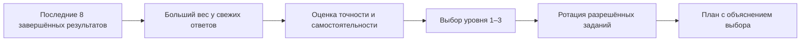

<p align="center">
  
</p>

<h1 align="center">Söyle</h1>

<p align="center">
  Платформа для короткой домашней практики, AAC-коммуникации<br />
  и понятной поддержки родителей.
</p>

<p align="center">
  
  
  
  
  
</p>


## О проекте

Söyle помогает семье проводить спокойные занятия длительностью 3–10 минут. Ребёнок выполняет игровые задания и может собирать фразы из AAC-карточек, а родитель видит результаты, создаёт практические цели и получает объяснимый план следующего занятия.

Платформа не ставит диагноз, не оценивает развитие и не заменяет врача или логопеда. Она организует домашнюю практику и хранит наблюдения отдельно от игровых результатов.

### Что уже работает

| Направление | Возможности |
|---|---|
| Детский режим | Короткие занятия, понятные инструкции, пауза и отказ без штрафа, AAC-конструктор фраз |
| Кабинет родителя | Цели, наблюдения, история занятий, предпочтения и объяснение каждого предложенного задания |
| Адаптация | Анализ недавних ответов, три уровня сложности, ротация упражнений и защита от повторов |
| Контент | Версионируемая библиотека; ребёнку доступны только опубликованные и разрешённые задания |
| Безопасность | Роли, HttpOnly-cookie, CSRF-защита, согласия, изоляция данных семей и журнал критических действий |
| Администрирование | Черновики упражнений, предварительный просмотр, проверка и блокировка публикации без утверждения |

## Адаптивный подбор без AI API

Вместо обращения к внешней нейросети Söyle использует собственный детерминированный алгоритм. Для одинаковых входных данных он всегда принимает одинаковое решение, а причины выбора сохраняются вместе с планом и отображаются родителю.



Алгоритм работает так:

1. Берёт до восьми последних завершённых результатов по нужному навыку.
2. Даёт свежим результатам больший вес: от `1.0` для самого старого до `2.0` для самого нового. Поэтому одна случайная ошибка не обрушает уровень, но устойчивые изменения быстро влияют на план.
3. Отдельно считает взвешенную точность и самостоятельность. Отказ, перерыв и техническая ошибка не считаются неправильным ответом.
4. Выбирает один из трёх уровней. При недостатке данных остаётся на спокойном стартовом уровне; повышение происходит только при устойчивом результате.
5. Оставляет только опубликованные задания, связанные с активной целью и не исключённые родителем.
6. Сначала предлагает новые упражнения, затем — использованные реже и давнее.

Внутри подготовленного плана задания уникальны. В игровых раундах один и тот же материал не выбирается повторно, пока не закончились другие подходящие варианты. Повтор допускается только после исчерпания доступного набора — это защищает занятия от монотонности, не делая маленький каталог непригодным.

Никакие ответы ребёнка, родительские вопросы или данные профиля не отправляются внешнему AI-провайдеру. Для работы адаптации не нужны API-ключи, токены или доступ к интернету.


## Технологии

- **Frontend:** Next.js 16, React 19, TypeScript, Web Speech API.
- **Backend:** FastAPI, Pydantic, PyJWT, Argon2.
- **Хранилище:** SQLite для локальной разработки, PostgreSQL для production.
- **Проверки:** Pytest, Node Test Runner, ESLint, Playwright и axe-core.

## Структура проекта

```text
Soyle/
├── backend/                 # API, база, миграции и адаптивный алгоритм
│   ├── app/
│   └── tests/
├── frontend/                # Интерфейс Next.js
│   ├── app/
│   ├── components/
│   ├── e2e/
│   └── tests/
├── start.sh                 # Единый локальный запуск
└── README.md
```

## Быстрый запуск

Понадобятся Python 3.11+, Node.js 20+, `npm` и `curl`.

```bash
git clone <адрес-репозитория>
cd Soyle
./start.sh
```

При первом запуске скрипт создаст Python-окружение, установит зависимости, применит локальные миграции и запустит обе части приложения.

После сообщения `Ready` доступны:

- лендинг — [http://localhost:3000](http://localhost:3000);
- приложение — [http://localhost:3000/app](http://localhost:3000/app);
- документация API — [http://127.0.0.1:8010/docs](http://127.0.0.1:8010/docs).

Остановка — `Ctrl+C`.

<details>
<summary><strong>Раздельный запуск для разработки</strong></summary>

Сначала запустите backend:

```bash
cd backend
python3 -m venv .venv
source .venv/bin/activate
python -m pip install -r requirements.txt
export SOYLE_SECRET_KEY="local-development-secret-change-me"
export SOYLE_SEED_DEMO_DATA=true
python -m app.migrations upgrade
python -m uvicorn app.main:app --reload --host 127.0.0.1 --port 8010
```

Во втором терминале запустите frontend:

```bash
cd frontend
npm install
cp .env.local.example .env.local
npm run dev
```

Не смешивайте `localhost` и `127.0.0.1` в адресах frontend/API: для cookie-сессии браузер считает их разными сайтами.

</details>

## Демо-доступ

Демо-пользователи создаются только при `SOYLE_SEED_DEMO_DATA=true`. В production этот режим заблокирован.

| Роль | Логин | Пароль или PIN |
|---|---|---|
| Родитель | `parent` | `Parent123!` |
| Ребёнок | `alikhan` | `1234` |
| Администратор | `admin` | `Admin123!` |

Для ребёнка на экране входа выберите вкладку **«Ребёнок»**, для родителя и администратора — **«Взрослый»**.

## Проверка проекта

Backend:

```bash
cd backend
source .venv/bin/activate
python -m pip install -r requirements-dev.txt
pytest -q
```

Frontend:

```bash
cd frontend
npm test
npm run lint
npm run build
npm run audit:visual
npm run test:e2e
```

`audit:visual` пересобирает каталог runtime-изображений и проверяет SHA-256, perceptual hash, битые ссылки и необоснованное повторное использование одного ассета в разных контекстах. Осознанные исключения для логотипов, AAC-символов и проверенных образовательных стимулов документируются отдельно.

Тесты покрывают авторизацию и роли, изоляцию данных, согласия, библиотеку заданий, взвешивание свежих результатов, смену сложности, ротацию без повторов, AAC-грамматику и основные сценарии ребёнка, родителя и администратора.

## Приватность и ограничения

- Камера используется только после отдельного согласия. Анализ выполняется в браузере; кадры и координаты лица не сохраняются и не отправляются на сервер.
- Видео и звук не сохраняются.
- Бытовые наблюдения родителя не превращаются в игровой балл.
- Адаптивный подбор и родительские подсказки выполняются локальными правилами без внешней AI API.
- Перед реальным пилотом нужны методическая проверка упражнений, юридическая проверка обработки детских данных и тестирование на реальных устройствах с ассистивными технологиями.


### MVP: реквизиты и удаление

Публичная страница `/privacy` читает `/api/privacy` и показывает фактические настройки сервера. До заполнения статус остаётся `mvp`; заполнение настроек не считается юридической экспертизой.

| Переменная окружения backend | Что должен определить владелец |
|---|---|
| `SOYLE_OPERATOR_NAME` | ФИО или наименование оператора |
| `SOYLE_OPERATOR_COUNTRY` | Страна оператора |
| `SOYLE_PRIVACY_CONTACT_EMAIL` | Рабочий контакт для запросов семьи |
| `SOYLE_HOSTING_LOCATION` | Размещение сервера, базы и обработчиков |
| `SOYLE_HISTORY_RETENTION_POLICY` | Утверждённые сроки хранения истории |
| `SOYLE_BACKUP_RETENTION_POLICY` | Наличие, размещение и сроки уничтожения копий |
| `SOYLE_DELETION_REQUEST_POLICY` | Срок ответа и способ выполнения запроса |

Это информационные поля, они не включают автоматическую очистку по расписанию. Сейчас история хранится до удаления родителем. Удаление профиля или всего аккаунта требует пароля и выполняется транзакцией в действующей базе: удаляются связанные записи ребёнка, детские входы, настройки, активные сессии входа и относящиеся к нему записи журналов. Другие семьи сохраняются. Удаление аккаунта доступно в профиле родителя; отдельного ребёнка — в кабинете родителя. Сначала при необходимости скачайте выгрузку.

Программа не управляет внешними резервными копиями. Перед пилотом оператор должен установить срок их уничтожения, вести защищённый журнал выполненных запросов на удаление вне восстанавливаемой копии и проверять восстановление в изолированной базе. После восстановления нужно повторно применить все удаления, произошедшие после создания копии, отозвать восстановленные сессии входа и проверить отсутствие удалённых профилей до открытия доступа. Старая копия не должна возвращать удалённые данные в работающий сервис. Такая процедура пока не подтверждена на инфраструктуре владельца.

### Доступ специалиста

Администратор назначает взрослому аккаунту роль специалиста; изменение роли отзывает прежние сессии. Семья включает отдельное разрешение, сохраняет его и добавляет конкретного специалиста по логину. Самого разрешения недостаточно. Существующие отключённые аккаунты автоматически не активируются.

Специалист видит только открытые ему профили, цели и историю, записывает отдельные бытовые наблюдения и рекомендации семье. Он не получает доступ к настройкам согласий, выгрузке, удалению, управлению аккаунтом или административным разделам. Рекомендовать можно только доступные этому ребёнку упражнения. Наблюдения не повышают игровой балл и не подтверждают освоение навыка. Родитель видит автора и содержание наблюдений и рекомендаций. Отзыв конкретного доступа или общего разрешения закрывает следующие запросы; повторное включение разрешения не восстанавливает старые связи.

### Независимая проверка перед пилотом

Технические тесты не подтверждают пользу упражнений или понимание ребёнком речи. Для каждой версии задания эксперт должен зафиксировать: целевое действие, аудиторию и ограничения, исходное понимание инструкции, допустимые способы ответа, виды помощи, условия остановки, отсутствие случайных подсказок и критерий наблюдения вне игры. Все картинки проверяются на узнаваемость и однозначность в контексте инструкции; правильный ответ не должен выделяться позицией, размером, цветом или подписью. Проверка относится к конкретной версии: замена изображения или инструкции требует повторной проверки.

Протокол проверки понимания: сначала дать знакомую инструкцию без показа ответа; записать первую реакцию, время ожидания и помощь; повторить с другим изображением того же предмета и новой позицией среди сопоставимых вариантов. Затем предложить реальный предмет в другой бытовой ситуации с другим взрослым, сохранив AAC, жест и взгляд как допустимые ответы. Результат переноса записывается отдельным наблюдением с ситуацией и уровнем помощи. Совпадение в игре не считается переносом. Отказ, перерыв и техническая ошибка не считаются неверным пониманием.

Наблюдаемая проверка с родителями и специалистами: вход и разрешения → короткое занятие → помощь/повтор → AAC → отказ/перерыв → сохранение и повторный вход → просмотр и выгрузка → отзыв доступа. Для каждого шага записать устройство, браузер, способ управления, действие без подсказки проверяющего, затруднение, ошибку и решение. Проверить на физических Android/iOS-устройствах звук, блокировку экрана, переключение приложений, нестабильную сеть, увеличение текста, клавиатуру, VoiceOver/TalkBack и включённое уменьшение движения. При дискомфорте или недоступной кнопке остановки проверку прекратить. Фамилии участников, разрешения и результаты должны фиксироваться ответственным за пилот. Пока такие проверки не проведены, их статус остаётся «не проверено».

### Проверка PostgreSQL в изоляции

Полный backend-набор поддерживает `SOYLE_TEST_DATABASE_URL=postgresql://localhost:PORT/soyle_test_NAME`. Допускается только локальный сервер и отдельная база с префиксом `soyle_test_`. Для каждого прогона нужна новая пустая база; рабочий `DATABASE_URL` тестами не используется. Миграции проверяются повторным применением без изменений. Сквозные браузерные тесты используют отдельную `/tmp/soyle-playwright.db`; проекты покрывают 1440 px, планшет, 390 px и 320 px. Эмуляция размеров и автоматическая axe-проверка не заменяют физических устройств и ассистивных технологий.

### Кабинеты и приглашения по ссылке

Кабинет родителя разделён на страницы «Обзор», «Практика», «Специалист», «Материалы», «Доступ и данные». Выбранный раздел сохраняется в адресе страницы и открывается после обновления; работает переход назад. Кабинет специалиста содержит страницы детей, наблюдений, рекомендаций, целей и истории. Черновики книг и комиксов перенесены в «Материалы».

Приглашение: в «Доступ и данные» включите и сохраните разрешение на доступ специалиста → в «Специалист» создайте ссылку → передайте её лично специалисту → специалист входит в существующий аккаунт с соответствующей ролью и отправляет запрос → родитель обновляет запросы, проверяет имя и логин и подтверждает доступ. Ссылка сама по себе не открывает профиль и не повышает роль аккаунта. Создание аккаунтов специалиста и назначение роли остаются отдельным действием администратора.

Ссылки одноразовые, действуют 24 часа. Создание новой ссылки отменяет предыдущую неиспользованную. Запрос можно отклонить, приглашение — отменить, предоставленный доступ — отозвать. Отзыв общего разрешения отменяет все открытые приглашения и ожидающие запросы и удаляет связи со специалистами. Секрет передаётся в URL-фрагменте, не входит в HTTP-адрес страницы и хранится в базе только в виде SHA-256; готовая ссылка показывается лишь в текущем сеансе создания. В выгрузку включены статусы приглашений без секретов. Для схемы требуется миграция 24.


## Переработка учебного ядра — 22 октября 2026

Добавлены версионируемые черновики знакомых слов с разными примерами и действий с одинаковым реквизитом. Комикс «Пикник для мишки» содержит 12 сцен и использует существующий движок интерактивной книги. Три старых коротких вопросника скрыты из детского каталога с сохранением истории. Новые материалы не опубликованы: штатные утверждения и разрешение выпуска ожидаются.

Реестр каждого старого задания и фактический статус — [inventory.json](docs/content-review/inventory.json). Подробный отчёт с источниками, паспортами, самопроверкой, проверками и незавершённой работой — [REPORT.txt](docs/content-review/REPORT.txt) и [review-record.json](docs/content-review/review-record.json). Самопроверка AI не является заключением логопеда или независимой экспертизой.

Проверка локальных изображений, хешей и звукового сигнала: `backend/.venv/bin/python scripts/check_learning_core.py`. Наличие файлов и успешная сборка не означают методического утверждения или публикации.

### Рекомендации на главной и очередь контента

На главной родителя блок «С чего начать» показывает последнюю утверждённую рекомендацию активного специалиста, которому семья сейчас предоставила доступ: исходный текст, имя и дату. Прикреплённое задание открывается только если оно по-прежнему доступно выбранному ребёнку. При отзыве доступа советы остаются в истории кабинета, но перестают предлагаться на главной как текущий первый шаг. Отсутствие рекомендаций и ошибка загрузки показаны отдельно.

Админ-панель открывается на вкладке «Задания»: общая очередь включает упражнения и бытовые игры, доступны поиск, выбор типа и фильтры проверки/доработки/готовности к публикации. У упражнений показаны четыре этапа и причина блокировки. Библиотека отделена от очереди; локальные демо-версии явно помечены как неутверждённые. Интерфейс не назначает права рецензентов и не обходит проверку публикации.
