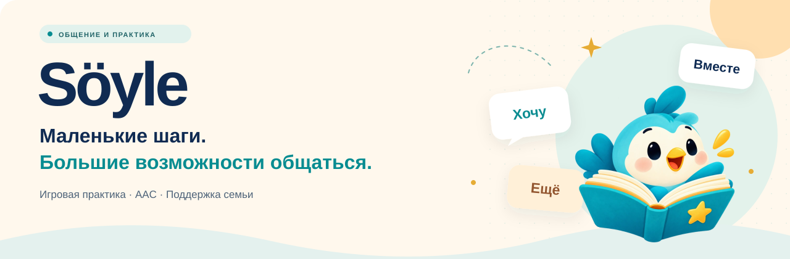
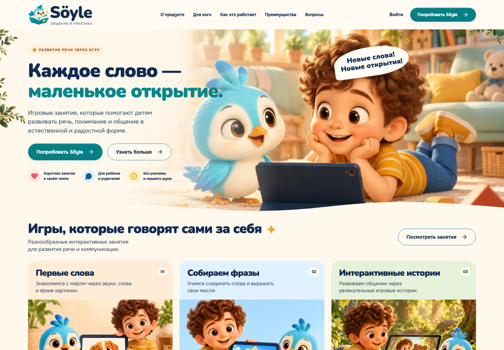
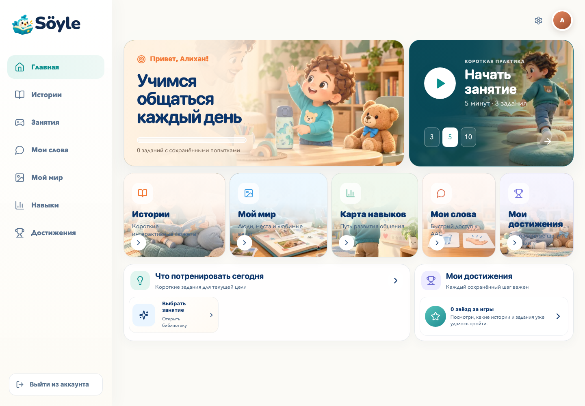
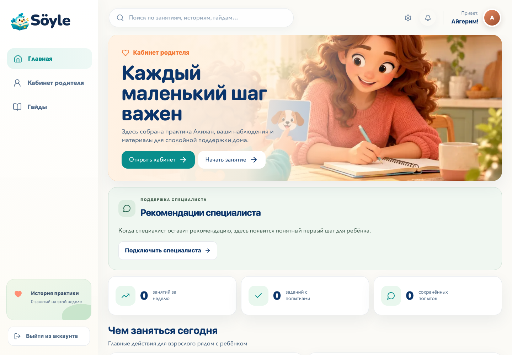
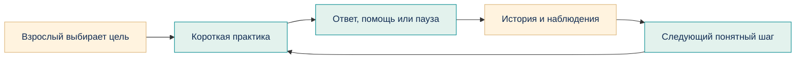

<p align="center">
  
</p>

<h1 align="center">Общаться. Играть. Быть услышанным.</h1>

<p align="center">
  <strong>Söyle</strong> — короткая домашняя практика, доступная коммуникация<br />
  и поддержка семьи в одном спокойном пространстве.
</p>

<p align="center">
  
  
  
  
</p>

<p align="center">
  <a href="#inside">О проекте</a> ·
  <a href="#screens">Скриншоты</a> ·
  <a href="#research">Задания и статьи</a> ·
  <a href="#quickstart">Запуск</a> ·
  <a href="#development">Разработка</a>
</p>

---

<a id="inside"></a>

## 01 / У каждого свой способ сказать

Показать картинку. Выбрать слово. Попросить ещё. Сделать паузу. Söyle помогает семье организовать такие маленькие шаги: ребёнок занимается в своём темпе, а взрослый видит историю практики и понимает, что предложить дальше.

В основе — занятия на **3, 5 или 10 минут**, игровые задания и **AAC**: дополнительная и альтернативная коммуникация с помощью карточек и озвучивания. Для ответа в предусмотренных механиках не требуется произносить слово вслух.

<table>
  <tr>
    <td width="33%" valign="top">
      <h3>🪁 Ребёнку</h3>
      <p>Понятные инструкции, знакомые предметы, карточки «Мои слова», личные материалы в «Моём мире» и достижения. Помощь, перерыв и отказ доступны без штрафа.</p>
    </td>
    <td width="33%" valign="top">
      <h3>🌿 Родителю</h3>
      <p>Цели, короткий план, история занятий и отдельные бытовые наблюдения. Гайды и рекомендации специалиста помогают выбрать следующий шаг.</p>
    </td>
    <td width="33%" valign="top">
      <h3>🤝 Специалисту</h3>
      <p>Профили, цели и история только тех детей, к которым семья открыла доступ. Наблюдения и рекомендации с указанием автора.</p>
    </td>
  </tr>
</table>

**Статус — MVP.** Söyle поддерживает домашнюю практику, не ставит диагноз и не заменяет врача или логопеда. Игровой результат и наблюдение в быту хранятся отдельно; клиническая эффективность приложения не исследована.

<a id="screens"></a>

## 02 / Заглянуть внутрь

**Первое знакомство** — тёплый лендинг с птичкой Söyle, знакомыми сюжетами и объяснением возможностей.

<a href="docs/readme/landing.png"></a>

<table>
  <tr>
    <td width="50%" valign="top">
      <a href="docs/readme/child.png"></a>
      <p><strong>Маленькие открытия ребёнка</strong><br />Свой темп, короткая практика и быстрый доступ к общению.</p>
    </td>
    <td width="50%" valign="top">
      <a href="docs/readme/parent.png"></a>
      <p><strong>Поддержка для взрослого</strong><br />Практика, наблюдения и следующий шаг собраны рядом.</p>
    </td>
  </tr>
</table>

<sub>Скриншоты локальной версии от 25 октября 2026 года, 1440 × 1000. Использованы демонстрационные аккаунты; изображения открываются в полном размере по нажатию.</sub>

## 03 / От первого выбора к следующему шагу



| Возможность | Как устроена в Söyle |
|---|---|
| **Практика** | Выбор предметов и действий по услышанной инструкции; задания с предметом, получателем и местом. Доступ зависит от версии, утверждений и настроек ребёнка. |
| **AAC-коммуникация** | Выбор и сборка доступных сообщений из карточек с озвучиванием. Предпочтения, чувства и отказ не оцениваются по правильности. |
| **Личные материалы** | Раздел «Мой мир» для знакомых людей, мест и вещей; описания отдельных картинок отделены от сюжетных историй. |
| **Работа с семьёй** | Цели, наблюдения, история, настройки, выгрузка и управление доступом специалиста. |
| **Подготовка контента** | Черновики, методические карточки, предпросмотр и проверки перед публикацией. Истории и новые наборы со статусом `DRAFT` закрыты для детского выпуска. |

### Адаптация, которую можно объяснить

Подбор выполняется собственным детерминированным алгоритмом **без внешней AI API**. Родитель видит причины выбора задания, а одинаковые входные данные приводят к одинаковому решению.

1. Алгоритм берёт до **8 последних сопоставимых завершённых результатов**. Свежие ответы получают больший вес: от `1.0` до `2.0`.
2. Учитывает точность, самостоятельность и помощь; выбирает один из **трёх уровней сложности**. При недостатке данных сохраняет спокойный стартовый уровень.
3. Отбирает разрешённые опубликованные версии с учётом активной цели и исключений родителя.
4. Чередует задания: сначала новые, затем использованные реже и давнее. В подготовленном плане задания уникальны; в раундах повтор допускается после исчерпания подходящего набора.

Отказ, перерыв и техническая ошибка учитываются отдельно от неправильного ответа. Ответы ребёнка и данные профиля не отправляются внешнему AI-провайдеру; для адаптации не нужны API-ключи. Часть проектных иллюстраций при подготовке контента создана с помощью AI.

<a id="research"></a>

## 04 / Какие задания опираются на статьи

В проекте есть задания, при разработке которых использовались исследования и профессиональные рекомендации. В сохранённых паспортах зафиксировано **заимствование общих принципов**, а не дословное воспроизведение готовых упражнений. Поэтому ниже указано, что именно стало основой и где эта связь записана.

| Задание или материал Söyle | Источник | Что использовано при разработке |
|---|---|---|
| **«Знакомые предметы: разные примеры»** — мяч, чашка, книга и ложка | [Ansari et al., 2025][ansari]; [ASHA: Spoken Language Disorders][asha-language] | Значимые знакомые слова, связь слова со значением и контекстом, индивидуальный подбор. Два изображения каждого понятия и число раундов разработаны для проекта. Связь записана в [паспорте ядра](backend/app/core_content.py). |
| **«Что делает ребёнок: одинаковые предметы»** — ест, пьёт, смотрит книгу, играет с мячом | [ASHA: Spoken Language Disorders][asha-language]; [Ansari et al., 2025][ansari] | Общий подход к индивидуальной языковой практике. Одинаковый реквизит во всех сценах — собственное решение Söyle; обзор словарных вмешательств не проверял эту механику действий. См. [методическую карточку](backend/app/core_content.py). |
| **Короткая практика слов и действий**, **«Дай предмет: мишке или взрослому»**, **«Положи предмет: в коробку или на стол»** | [ASHA: Spoken Language Disorders][asha-language]; [ASHA: AAC][asha-aac] | Индивидуальная языковая цель, доступный способ ответа и функциональная ситуация. Эти ссылки указаны в [паспортах текущих вариантов](backend/app/practice_content.py). Иллюстрации, 4–8 раундов и последовательность помощи — настройки проекта. |
| **«Пикник для мишки»** — интерактивная история из 12 сцен | [Takacs, Swart & Bus, 2015][takacs]; [ASHA: AAC][asha-aac]; [Roberts et al., 2019][roberts] | Учтён риск отвлекающей интерактивности; взаимодействия привязаны к сюжету, предусмотрены просьба, отказ и участие взрослого. Сюжет и ветки созданы для Söyle. Основание сохранено в паспорте `PICNIC-PASSPORT` в [записи проверки](docs/content-review/review-record.json); реализация — [picnic_content.py](backend/app/picnic_content.py). |

**Границы этих заимствований.** Ansari et al. рассматривают детей 5–11 лет с DLD; Roberts et al. — программы обучения родителей в исследованиях со средним возрастом детей менее 6 лет; Takacs et al. — цифровые истории у маленьких детей из разных групп. ASHA — профессиональные рекомендации. Эти источники не подтверждают эффективность Söyle, заданное число сцен или раундов и не позволяют автоматически переносить выводы на любую алалию или русскоязычного ребёнка. Памятка приложения не равна исследованной программе обучения родителей.

**Статус материалов.** Исследовательское ядро и «Пикник для мишки» подготовлены как `DRAFT / pending`. Наличие источника, предпросмотра или успешной сборки не означает методического утверждения. Выпуск требует предусмотренных проверок: технической, методической, доступности и разрешения публикации. Самопроверка AI не заменяет независимую экспертизу.

<details>
<summary><strong>Полные названия статей и рекомендаций</strong></summary>

1. **Ansari, R., Chiat, S., Cartwright, M., & Herman, R. (2025).** [Vocabulary interventions for children with developmental language disorder: a systematic review][ansari]. *Frontiers in Psychology, 16*, 1517311. DOI: `10.3389/fpsyg.2025.1517311`.
2. **Roberts, M. Y., Curtis, P. R., Sone, B. J., & Hampton, L. H. (2019).** [Association of Parent Training With Child Language Development: A Systematic Review and Meta-analysis][roberts]. *JAMA Pediatrics, 173*(7), 671–680. DOI: `10.1001/jamapediatrics.2019.1197`.
3. **Takacs, Z. K., Swart, E. K., & Bus, A. G. (2015).** [Benefits and Pitfalls of Multimedia and Interactive Features in Technology-Enhanced Storybooks: A Meta-Analysis][takacs]. *Review of Educational Research, 85*(4), 698–739. DOI: `10.3102/0034654314566989`.
4. **American Speech-Language-Hearing Association.** [Spoken Language Disorders][asha-language]. *ASHA Practice Portal*.
5. **American Speech-Language-Hearing Association.** [Augmentative and Alternative Communication (AAC)][asha-aac]. *ASHA Practice Portal*.

Происхождение материалов, ограничения источников и результаты самопроверки сохранены в [review-record.json](docs/content-review/review-record.json). Реестр старых и новых заданий — [inventory.json](docs/content-review/inventory.json); подробный отчёт — [REPORT.txt](docs/content-review/REPORT.txt).

</details>

<a id="quickstart"></a>

## 05 / Попробовать локально

Нужны **Python 3.11+**, **Node.js 20.9+**, `npm`, `curl` и `zsh` для общего скрипта запуска.

```bash
git clone https://github.com/whynicky19/Soyle.git
cd Soyle
./start.sh
```

Скрипт создаст Python-окружение при необходимости, установит зависимости, применит локальные миграции, создаст демо-аккаунты и запустит обе части приложения. Для первого запуска нужен интернет, чтобы скачать зависимости.

| Открыть | Адрес |
|---|---|
| Знакомство с проектом | [localhost:3000](http://localhost:3000) |
| Вход в приложение | [localhost:3000/app](http://localhost:3000/app) |
| Документация API | [127.0.0.1:8010/docs](http://127.0.0.1:8010/docs) |

Остановка — `Ctrl+C`. Если порт `8010` уже занят, остановите предыдущий запуск. В браузере используйте `localhost` для frontend и API: cookie-сессия требует согласованных адресов.

### Демо-доступ

| Роль | Логин | Пароль / PIN | Вкладка входа |
|---|---|---|---|
| Родитель | `parent` | `Parent123!` | Взрослый |
| Ребёнок | `alikhan` | `1234` | Ребёнок |
| Администратор | `admin` | `Admin123!` | Взрослый |

Демо-аккаунты создаются только при `SOYLE_SEED_DEMO_DATA=true`; в production этот режим заблокирован. Для сохранения результатов ребёнка родитель должен включить соответствующее разрешение в разделе **«Доступ и данные»**.

<details>
<summary><strong>Раздельный запуск backend и frontend</strong></summary>

Backend — из корня репозитория:

```bash
cd backend
python3 -m venv .venv
source .venv/bin/activate
python -m pip install -r requirements.txt
export SOYLE_SECRET_KEY="local-development-secret-change-me"
export SOYLE_SEED_DEMO_DATA=true
python -m app.migrations upgrade
python -m uvicorn app.main:app --reload --host 127.0.0.1 --port 8010
```

Frontend — во втором терминале, из корня репозитория:

```bash
cd frontend
npm install
test -f .env.local || cp .env.local.example .env.local
npm run dev
```

Если `.env.local` уже существует, сохраните свои настройки и проверьте `NEXT_PUBLIC_API_URL=http://localhost:8010` перед запуском. Не смешивайте `localhost` и `127.0.0.1` в браузерных адресах frontend/API.

</details>

<a id="development"></a>

## 06 / Под капотом

| Слой | Технологии |
|---|---|
| Интерфейс | Next.js 16, React 19, TypeScript, GSAP, Lucide |
| Звук и отдельные камерные прототипы | Web Speech API, MediaPipe Tasks Vision |
| Сервер | FastAPI, Pydantic, PyJWT, Argon2 |
| Хранение | SQLite локально; поддержка PostgreSQL для развёртывания |
| Проверки | Pytest, Node Test Runner, ESLint, Playwright, axe-core |

```text
Soyle/
├── frontend/
│   ├── app/                  # Лендинг, приложение, privacy и terms
│   ├── components/           # Интерфейсы ребёнка, семьи, специалиста и админа
│   ├── lib/                  # API и клиентская логика
│   ├── public/               # Иллюстрации, AAC-символы, шрифты и звук
│   ├── tests/                # Проверки клиентской логики
│   └── e2e/                  # Браузерные сценарии
├── backend/
│   ├── app/                  # API, адаптация, контент, миграции и доступ
│   └── tests/                # Серверные проверки
├── docs/
│   ├── readme/               # Обложка и скриншоты этого README
│   └── content-review/       # Происхождение заданий и материалы проверки
├── scripts/                  # Проверка изображений и учебного контента
├── start.sh                  # Общий локальный запуск
└── README.md
```

<details>
<summary><strong>Команды проверки проекта</strong></summary>

Backend:

```bash
cd backend
source .venv/bin/activate
python -m pip install -r requirements-dev.txt
pytest -q
```

Frontend:

```bash
cd frontend
npm test
npm run lint
npm run build
npx playwright install chromium
npm run test:e2e
```

Из корня репозитория:

```bash
backend/.venv/bin/python scripts/visual_asset_audit.py --write --check
backend/.venv/bin/python scripts/check_learning_core.py
```

`npm run audit:visual` в frontend запускает ту же проверку изображений: SHA-256, perceptual hash, битые ссылки и повторное использование ассетов. Исключения для логотипов, AAC-символов и образовательных стимулов документируются отдельно. Для Python-проверок изображений нужна Pillow; она входит в `backend/requirements-dev.txt`. При необходимости используйте Python из backend-окружения.

Тесты охватывают роли и авторизацию, изоляцию семей, согласия, контент, адаптацию, ротацию, AAC-грамматику и основные пользовательские сценарии. Браузерные проверки используют отдельную тестовую базу и размеры desktop, tablet, 390 и 320 px.

</details>

<a id="privacy"></a>

## 07 / Доверие начинается с понятных правил

- **Семья управляет доступом.** Специалист получает данные только после разрешения и подтверждения родителем; доступ можно отозвать.
- **Данные семей изолированы.** Применяются роли, HttpOnly-cookie, CSRF-защита, согласия и журнал критических действий.
- **Камера — по отдельному согласию.** В камерных механиках обработка идёт в браузере; кадры и координаты лица не сохраняются и не отправляются на сервер. Видео и звук не записываются.
- **Наблюдение не становится баллом.** Бытовые ответы, помощь, перерывы и игровые результаты различаются в учёте.
- **Публикация требует проверки.** До реального пилота остаются независимая методическая экспертиза, проверка обработки детских данных и испытания на реальных устройствах с ассистивными технологиями.

<details>
<summary><strong>Приватность, доступ специалиста и проверка перед пилотом</strong></summary>

### MVP: реквизиты и удаление

Публичная страница `/privacy` читает `/api/privacy` и показывает фактические настройки сервера. До заполнения статус остаётся `mvp`; заполнение настроек не считается юридической экспертизой.

| Переменная окружения backend | Что должен определить владелец |
|---|---|
| `SOYLE_OPERATOR_NAME` | ФИО или наименование оператора |
| `SOYLE_OPERATOR_COUNTRY` | Страна оператора |
| `SOYLE_PRIVACY_CONTACT_EMAIL` | Рабочий контакт для запросов семьи |
| `SOYLE_HOSTING_LOCATION` | Размещение сервера, базы и обработчиков |
| `SOYLE_HISTORY_RETENTION_POLICY` | Утверждённые сроки хранения истории |
| `SOYLE_BACKUP_RETENTION_POLICY` | Наличие, размещение и сроки уничтожения копий |
| `SOYLE_DELETION_REQUEST_POLICY` | Срок ответа и способ выполнения запроса |

Это информационные поля, они не включают автоматическую очистку по расписанию. Сейчас история хранится до удаления родителем. Удаление профиля или всего аккаунта требует пароля и выполняется транзакцией в действующей базе: удаляются связанные записи ребёнка, детские входы, настройки, активные сессии входа и относящиеся к нему записи журналов. Другие семьи сохраняются. Удаление аккаунта доступно в профиле родителя; отдельного ребёнка — в кабинете родителя. Сначала при необходимости скачайте выгрузку.

Программа не управляет внешними резервными копиями. Перед пилотом оператор должен установить срок их уничтожения, вести защищённый журнал выполненных запросов на удаление вне восстанавливаемой копии и проверять восстановление в изолированной базе. После восстановления нужно повторно применить все удаления, произошедшие после создания копии, отозвать восстановленные сессии входа и проверить отсутствие удалённых профилей до открытия доступа. Старая копия не должна возвращать удалённые данные в работающий сервис. Такая процедура пока не подтверждена на инфраструктуре владельца.

### Доступ специалиста

Администратор назначает взрослому аккаунту роль специалиста; изменение роли отзывает прежние сессии. Семья включает отдельное разрешение, сохраняет его и добавляет конкретного специалиста по логину. Самого разрешения недостаточно. Существующие отключённые аккаунты автоматически не активируются.

Специалист видит только открытые ему профили, цели и историю, записывает отдельные бытовые наблюдения и рекомендации семье. Он не получает доступ к настройкам согласий, выгрузке, удалению, управлению аккаунтом или административным разделам. Рекомендовать можно только доступные этому ребёнку упражнения. Наблюдения не повышают игровой балл и не подтверждают освоение навыка. Родитель видит автора и содержание наблюдений и рекомендаций. Отзыв конкретного доступа или общего разрешения закрывает следующие запросы; повторное включение разрешения не восстанавливает старые связи.

### Независимая проверка перед пилотом

Технические тесты не подтверждают пользу упражнений или понимание ребёнком речи. Для каждой версии задания эксперт должен зафиксировать: целевое действие, аудиторию и ограничения, исходное понимание инструкции, допустимые способы ответа, виды помощи, условия остановки, отсутствие случайных подсказок и критерий наблюдения вне игры. Все картинки проверяются на узнаваемость и однозначность в контексте инструкции; правильный ответ не должен выделяться позицией, размером, цветом или подписью. Проверка относится к конкретной версии: замена изображения или инструкции требует повторной проверки.

Протокол проверки понимания: сначала дать знакомую инструкцию без показа ответа; записать первую реакцию, время ожидания и помощь; повторить с другим изображением того же предмета и новой позицией среди сопоставимых вариантов. Затем предложить реальный предмет в другой бытовой ситуации с другим взрослым, сохранив AAC, жест и взгляд как допустимые ответы. Результат переноса записывается отдельным наблюдением с ситуацией и уровнем помощи. Совпадение в игре не считается переносом. Отказ, перерыв и техническая ошибка не считаются неверным пониманием.

Наблюдаемая проверка с родителями и специалистами: вход и разрешения → короткое занятие → помощь/повтор → AAC → отказ/перерыв → сохранение и повторный вход → просмотр и выгрузка → отзыв доступа. Для каждого шага записать устройство, браузер, способ управления, действие без подсказки проверяющего, затруднение, ошибку и решение. Проверить на физических Android/iOS-устройствах звук, блокировку экрана, переключение приложений, нестабильную сеть, увеличение текста, клавиатуру, VoiceOver/TalkBack и включённое уменьшение движения. При дискомфорте или недоступной кнопке остановки проверку прекратить. Фамилии участников, разрешения и результаты должны фиксироваться ответственным за пилот. Пока такие проверки не проведены, их статус остаётся «не проверено».

### Проверка PostgreSQL в изоляции

Полный backend-набор поддерживает `SOYLE_TEST_DATABASE_URL=postgresql://localhost:PORT/soyle_test_NAME`. Допускается только локальный сервер и отдельная база с префиксом `soyle_test_`. Для каждого прогона нужна новая пустая база; рабочий `DATABASE_URL` тестами не используется. Миграции проверяются повторным применением без изменений. Сквозные браузерные тесты используют отдельную `/tmp/soyle-playwright.db`; проекты покрывают 1440 px, планшет, 390 px и 320 px. Эмуляция размеров и автоматическая axe-проверка не заменяют физических устройств и ассистивных технологий.

### Кабинеты и приглашения по ссылке

Кабинет родителя разделён на страницы «Обзор», «Практика», «Специалист», «Материалы», «Доступ и данные». Выбранный раздел сохраняется в адресе страницы и открывается после обновления; работает переход назад. Кабинет специалиста содержит страницы детей, наблюдений, рекомендаций, целей и истории. Черновики книг и комиксов перенесены в «Материалы».

Приглашение: в «Доступ и данные» включите и сохраните разрешение на доступ специалиста → в «Специалист» создайте ссылку → передайте её лично специалисту → специалист входит в существующий аккаунт с соответствующей ролью и отправляет запрос → родитель обновляет запросы, проверяет имя и логин и подтверждает доступ. Ссылка сама по себе не открывает профиль и не повышает роль аккаунта. Создание аккаунтов специалиста и назначение роли остаются отдельным действием администратора.

Ссылки одноразовые, действуют 24 часа. Создание новой ссылки отменяет предыдущую неиспользованную. Запрос можно отклонить, приглашение — отменить, предоставленный доступ — отозвать. Отзыв общего разрешения отменяет все открытые приглашения и ожидающие запросы и удаляет связи со специалистами. Секрет передаётся в URL-фрагменте, не входит в HTTP-адрес страницы и хранится в базе только в виде SHA-256; готовая ссылка показывается лишь в текущем сеансе создания. В выгрузку включены статусы приглашений без секретов. Для схемы требуется миграция 24.

</details>

<details>
<summary><strong>Текущая логика рекомендаций и очередь контента</strong></summary>

На главной родителя блок «Рекомендации специалиста» показывает последнюю утверждённую рекомендацию активного специалиста, которому семья сейчас предоставила доступ: исходный текст, имя и дату. Прикреплённое задание открывается только если оно по-прежнему доступно выбранному ребёнку. При отзыве доступа советы остаются в истории кабинета, но перестают предлагаться на главной как текущий первый шаг. Отсутствие рекомендаций и ошибка загрузки показаны отдельно.

Админ-панель открывается на вкладке «Задания»: общая очередь включает упражнения и бытовые игры, доступны поиск, выбор типа и фильтры проверки/доработки/готовности к публикации. У упражнений показаны четыре этапа и причина блокировки. Библиотека отделена от очереди; локальные демо-версии явно помечены как неутверждённые. Интерфейс не назначает права рецензентов и не обходит проверку публикации.

Три прежних коротких вопросника скрыты из детского каталога с сохранением истории. Новое учебное ядро и «Пикник для мишки» остаются материалами подготовки; их наличие в репозитории не означает публикацию. Фактические статусы и незавершённая работа описаны в [реестре](docs/content-review/inventory.json) и [отчёте](docs/content-review/REPORT.txt).

</details>

---

<p align="center">
  <br />
  <strong>У маленького шага тоже есть голос.</strong><br />
  <sub>Söyle · общение и практика в своём темпе</sub>
</p>

[ansari]: https://pmc.ncbi.nlm.nih.gov/articles/PMC11962024/
[roberts]: https://pubmed.ncbi.nlm.nih.gov/31107508/
[takacs]: https://pubmed.ncbi.nlm.nih.gov/26640299/
[asha-language]: https://www.asha.org/practice-portal/clinical-topics/spoken-language-disorders/
[asha-aac]: https://www.asha.org/practice-portal/professional-issues/augmentative-and-alternative-communication/

## Azure Speech TTS

The checked-in frontend is Next.js/React (not Nuxt); all existing speech buttons
use `frontend/lib/speech.ts`. `frontend/hooks/useSpeech.ts` exposes
`speak(text, language)`, `stop()`, `repeat()`, `isSpeaking`, `isLoading`, and
`mode`/`setMode('normal' | 'slow')`. Exercise language comes from
`exercise.engine.language`, independently of interface language. Current published
exercises are Russian; adding Azure Kazakh support does **not** translate or publish
Kazakh exercises. The vocabulary catalogue contains a small nonpersonal Kazakh set;
add the exact Kazakh teaching texts through the editorial file before publication.

Backend-only environment (set in the deployment secret manager):

```dotenv
AZURE_TTS_ENABLED=true
AZURE_SPEECH_KEY=<Speech resource key>
AZURE_SPEECH_REGION=westeurope
```

For local development, `./start.sh` loads these three Azure variables from
`backend/.env.local`, falling back to the root `.env.local`; explicit shell variables
have priority. Other settings (database/authentication) are not changed by this loader.
Restart `./start.sh` after editing `.env.local` — Python source hot reload does not
reload environment files. The local launcher is `python -m app.local_server` from
`backend/`; production continues to use environment variables supplied by hosting.

Set `AZURE_TTS_ENABLED=false` to use existing bundled audio and local device voices.
Never place the key in `NEXT_PUBLIC_*`, client configuration, screenshots, or Git.
Install `backend/requirements.txt`, then run the existing controlled migration before
starting the new backend:

```sh
cd backend
python -m app.migrations upgrade
python -m app.migrations check
```

Migration 37 creates the shared audio cache, synthesis leases, quota state, and
per-user counters in the existing PostgreSQL database (SQLite remains supported for
local development). All replicas and pre-generation jobs using one Speech resource
must use **the same database**. Do not share that Azure resource with unmetered apps:
our 20 requests per rolling minute and conservative 500,000-character UTC monthly
budget only cover calls made through Söyle. Failed calls reserve budget too. Monitor
Azure's own metrics and budget alerts. Do not reset `tts_control` during deployments.
Expired in-flight leases recover after 20 seconds; network calls are outside DB
transactions. Audio is stored as base64 MP3, keyed by text/language/voice/mode/manual
pronunciation/version. Replays use this persistent cache, including after restart.
Old catalogue revisions may be deleted from `tts_cache` during maintenance; deleting
cache entries costs synthesis quota on subsequent playback. Include cache storage
in database capacity and backup planning.

`POST /api/tts` retains cookie/bearer authorization and CSRF protection, accepts at
most 300 characters, `language: ru | kk`, and `mode: normal | slow`. The old `rate`
parameter remains compatible (`rate < .75` selects slow). The voices are
`ru-RU-SvetlanaNeural` and `kk-KZ-AigulNeural`; slow mode uses SSML `rate="-15%"`,
with the same voice pitch as normal mode. Following voice feedback, both modes use
a gentle SSML pitch lift of +5%; the browser does not shift pitch or speed. Sentence
boundaries are marked explicitly and editorial punctuation is retained. Azure MP3
always plays at playbackRate 1. The endpoint
limits each authenticated account to 60 requests/minute, including cache hits;
provider failures open a shared cooldown, respect numeric Retry-After, and do not
trigger automatic paid retries. The frontend's request timeout is 12 seconds.

Only exact matches in the **server-owned static catalogue** reach Azure. No child
name, diagnosis, account metadata, custom AAC card, uploaded-photo caption, or free
text is sent to Azure. Fictional story-character names come from static story content.
Published database edits are not automatically trusted as cloud-safe: add reviewed
nonpersonal text to `backend/app/tts_editorial.json`. Existing bundled recordings
remain the first fallback; otherwise the browser may use only an installed local
voice (`localService=true`) matching the requested language. If unavailable, the
player returns false so the existing visual/retry flow remains available. The former
macOS `say` subprocess path is no longer run on arbitrary endpoint input; the local
asset-generation script remains available. HTTP bodies/provider errors are not logged
by the TTS service; ensure production APM/reverse proxies also redact request bodies
and subscription-key headers.

### Manual pronunciation review

Do not automatically rewrite exercise text. To add a safe text or override its
spoken pronunciation, add an entry to `backend/app/tts_editorial.json` after review:

```json
[
  {
    "language": "ru",
    "text": "Замок",
    "spoken_text": "За́мок",
    "approved": true,
    "reviewed_by": "<actual reviewer identifier>",
    "reviewed_at": "<actual review date>"
  }
]
```

The example is not an approval and is not installed by default. A logopedist should
listen to both modes with the intended pictures/context, then record the real review.
Only entries with `approved`, `reviewed_by`, and `reviewed_at` are loaded. SSML tags
in `spoken_text` are escaped: arbitrary markup is not executed. Redeploy/restart
workers after editorial changes. A correction changes the cache key automatically;
visible exercise text remains unchanged. Review/publish exercise content using the
existing content-review workspace as before. Baseline Azure outputs are not claimed
to have undergone a clinical review.

### Usage rights and pre-generation

Technical F0 support does not imply production/output redistribution rights.
[Microsoft Product Terms](https://www.microsoft.com/licensing/terms/en-US/product/MicrosoftAzure/all)
explicitly describe prebuilt TTS output-use rights for **paid-tier customers**.
Before production caching, distribution, or pre-generation, confirm rights under your
subscription/agreement; use S0 where required. F0 can be used for permitted evaluation,
with the same conservative limits. No credentials or billing tier are changed by this
integration. Standard neural voice support and current quotas are documented in
[language support](https://learn.microsoft.com/azure/ai-services/speech-service/language-support?tabs=tts),
[REST synthesis](https://learn.microsoft.com/azure/ai-services/speech-service/rest-text-to-speech),
and [quotas](https://learn.microsoft.com/azure/ai-services/speech-service/speech-services-quotas-and-limits).

Once rights are established, warm the same shared cache (no separate public audio
library and no bypass of quotas):

```sh
cd backend
python scripts/generate_tts_assets.py --azure --confirm-output-rights --language ru --mode both --limit 20
python scripts/generate_tts_assets.py --azure --confirm-output-rights --language kk --mode both --limit 9
```

The command assumes migrated DB and exported server environment, stops on quota/error,
and can be rerun safely. Without `--azure` it retains the existing macOS local library
workflow. On Safari/iOS playback must start from a user gesture: the shared media
element is unlocked in that gesture and reused after the server response. Autoplay
refusal is reported as unsuccessful playback, never as a completed listening task.
Test on an actual iPhone/iPad with installed RU/KK local voices and disabled network
before production; automated WebKit checks cannot certify device audio or pronunciation.

Automated checks (no Azure credentials or billable calls):

```sh
cd backend
python -m pytest -q
# Optional isolated local PostgreSQL: SOYLE_TEST_DATABASE_URL=postgresql://127.0.0.1:PORT/soyle_test_NAME
cd ../frontend
npm test
npx tsc --noEmit
npm run lint
npx playwright install webkit
npx playwright test --config playwright.speech.config.ts
```

The media tests use a valid short audio fixture and exercise the real browser player;
provider tests stub Azure responses. They do not certify the acoustic quality of
Svetlana/Aigul or availability of voices in a particular Azure region. Perform a
production-key smoke test with only generic catalogue phrases, then have a logopedist
approve the pronunciation in both modes. Update public privacy/operator information
and document the selected Azure region before launch.

Validation on 2026-10-31: 204 backend tests and 81 frontend tests passed; the 19
Azure-specific tests also passed on a fresh isolated PostgreSQL instance. Twelve
media-player tests passed across Chromium desktop/mobile and WebKit (RU/KK, both
modes); two additional tests passed on the actual child screen (desktop/mobile).
TypeScript, ESLint and the production build passed. Five tests in the older
`soyle-core-content.spec.ts` mobile suite failed on catalogue/feedback/selector
expectations; that broader suite is not reported as passing. Its fixtures, like the
other speech mocks, now explicitly declare installed local voices. No live Azure
request, actual iOS hardware verification, or clinical pronunciation approval was
performed.

Local smoke test on 2026-10-31 after fixing environment-file loading: the authenticated
endpoint returned `X-Soyle-TTS: azure` for «Мяч» in normal and slow modes; a repeated
normal request returned the cached audio (about 0.01 s versus about 2 s initially).
This confirms actual Azure connectivity, not clinical pronunciation approval.

Russian question intonation: every explicitly punctuated question now receives a
sentence-level SSML contour. Yes/no invitations (including «Поиграем?» and «Начнём?»)
use a later rise; question-word sentences («Кто пьёт?», «Где мяч?») use an earlier
peak. Statements are unchanged, punctuation is not inferred, and these Russian
profiles are not applied to Kazakh. SSML changes invalidate the synthesis cache.
Azure treats prosody as a hint and documents limitations for single words/short
phrases; listen to the generated outputs before editorial approval. Live samples
for the three phrases returned Azure audio after the change; the 30 focused TTS
tests passed. No clinical approval is implied.

Additional listener feedback on «Поиграем?» led to an exact-phrase contour override:
the rise now peaks earlier, around the stressed part of this invitation, then falls
softly. This timing is not copied to other words. Svetlana, the visible/spoken text,
and the base +5% pitch remain unchanged; both playback modes synthesize the contour
natively in Azure, with no syllable splicing or audio pitch post-processing. Native
Dariya and a widened-range Svetlana sample were also generated for evaluation; neither
replaces the site's voice. The revised normal/slow samples still require perceptual
approval; automated tests only establish the synthesis and routing behavior.
