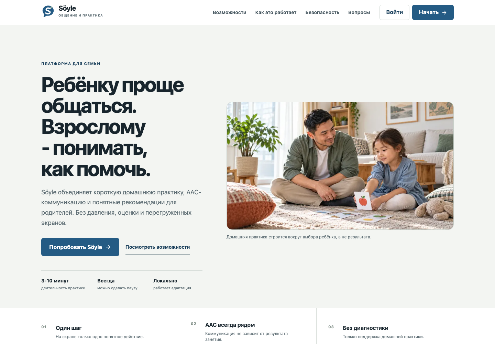
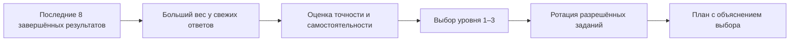
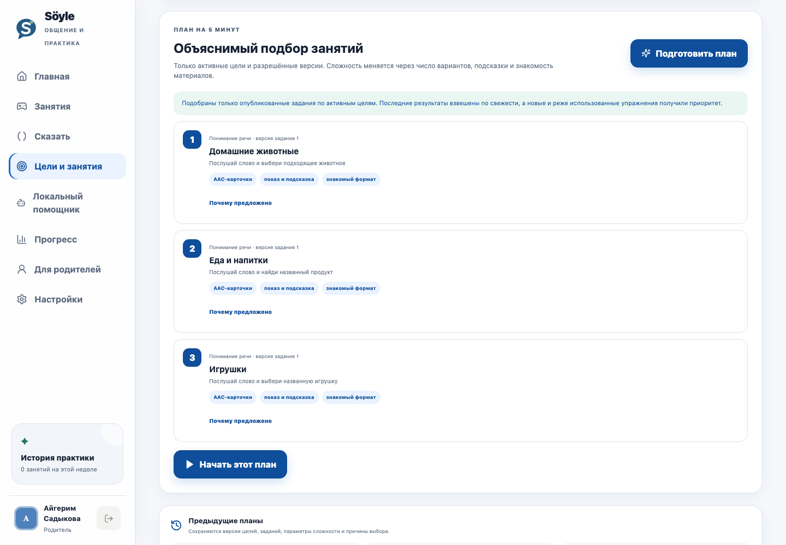

<p align="center">
  
</p>

<h1 align="center">Söyle</h1>

<p align="center">
  Платформа для короткой домашней практики, AAC-коммуникации<br />
  и понятной поддержки родителей.
</p>

<p align="center">
  
  
  
  
  
</p>



## О проекте

Söyle помогает семье проводить спокойные занятия длительностью 3–10 минут. Ребёнок выполняет игровые задания и может собирать фразы из AAC-карточек, а родитель видит результаты, создаёт практические цели и получает объяснимый план следующего занятия.

Платформа не ставит диагноз, не оценивает развитие и не заменяет врача или логопеда. Она организует домашнюю практику и хранит наблюдения отдельно от игровых результатов.

### Что уже работает

| Направление | Возможности |
|---|---|
| Детский режим | Короткие занятия, понятные инструкции, пауза и отказ без штрафа, AAC-конструктор фраз |
| Кабинет родителя | Цели, наблюдения, история занятий, предпочтения и объяснение каждого предложенного задания |
| Адаптация | Анализ недавних ответов, три уровня сложности, ротация упражнений и защита от повторов |
| Контент | Версионируемая библиотека; ребёнку доступны только опубликованные и разрешённые задания |
| Безопасность | Роли, HttpOnly-cookie, CSRF-защита, согласия, изоляция данных семей и журнал критических действий |
| Администрирование | Черновики упражнений, предварительный просмотр, проверка и блокировка публикации без утверждения |

## Адаптивный подбор без AI API

Вместо обращения к внешней нейросети Söyle использует собственный детерминированный алгоритм. Для одинаковых входных данных он всегда принимает одинаковое решение, а причины выбора сохраняются вместе с планом и отображаются родителю.



Алгоритм работает так:

1. Берёт до восьми последних завершённых результатов по нужному навыку.
2. Даёт свежим результатам больший вес: от `1.0` для самого старого до `2.0` для самого нового. Поэтому одна случайная ошибка не обрушает уровень, но устойчивые изменения быстро влияют на план.
3. Отдельно считает взвешенную точность и самостоятельность. Отказ, перерыв и техническая ошибка не считаются неправильным ответом.
4. Выбирает один из трёх уровней. При недостатке данных остаётся на спокойном стартовом уровне; повышение происходит только при устойчивом результате.
5. Оставляет только опубликованные задания, связанные с активной целью и не исключённые родителем.
6. Сначала предлагает новые упражнения, затем — использованные реже и давнее.

Внутри подготовленного плана задания уникальны. В игровых раундах один и тот же материал не выбирается повторно, пока не закончились другие подходящие варианты. Повтор допускается только после исчерпания доступного набора — это защищает занятия от монотонности, не делая маленький каталог непригодным.

Никакие ответы ребёнка, родительские вопросы или данные профиля не отправляются внешнему AI-провайдеру. Для работы адаптации не нужны API-ключи, токены или доступ к интернету.



## Технологии

- **Frontend:** Next.js 16, React 19, TypeScript, Web Speech API.
- **Backend:** FastAPI, Pydantic, PyJWT, Argon2.
- **Хранилище:** SQLite для локальной разработки, PostgreSQL для production.
- **Проверки:** Pytest, Node Test Runner, ESLint, Playwright и axe-core.

## Структура проекта

```text
Soyle/
├── backend/                 # API, база, миграции и адаптивный алгоритм
│   ├── app/
│   └── tests/
├── frontend/                # Интерфейс Next.js
│   ├── app/
│   ├── components/
│   ├── e2e/
│   └── tests/
├── docs/screenshots/        # Изображения для README
├── start.sh                 # Единый локальный запуск
└── README.md
```

## Быстрый запуск

Понадобятся Python 3.11+, Node.js 20+, `npm` и `curl`.

```bash
git clone <адрес-репозитория>
cd Soyle
./start.sh
```

При первом запуске скрипт создаст Python-окружение, установит зависимости, применит локальные миграции и запустит обе части приложения.

После сообщения `Ready` доступны:

- лендинг — [http://localhost:3000](http://localhost:3000);
- приложение — [http://localhost:3000/app](http://localhost:3000/app);
- документация API — [http://127.0.0.1:8010/docs](http://127.0.0.1:8010/docs).

Остановка — `Ctrl+C`.

<details>
<summary><strong>Раздельный запуск для разработки</strong></summary>

Сначала запустите backend:

```bash
cd backend
python3 -m venv .venv
source .venv/bin/activate
python -m pip install -r requirements.txt
export SOYLE_SECRET_KEY="local-development-secret-change-me"
export SOYLE_SEED_DEMO_DATA=true
python -m app.migrations upgrade
python -m uvicorn app.main:app --reload --host 127.0.0.1 --port 8010
```

Во втором терминале запустите frontend:

```bash
cd frontend
npm install
cp .env.local.example .env.local
npm run dev
```

Не смешивайте `localhost` и `127.0.0.1` в адресах frontend/API: для cookie-сессии браузер считает их разными сайтами.

</details>

## Демо-доступ

Демо-пользователи создаются только при `SOYLE_SEED_DEMO_DATA=true`. В production этот режим заблокирован.

| Роль | Логин | Пароль или PIN |
|---|---|---|
| Родитель | `parent` | `Parent123!` |
| Ребёнок | `alikhan` | `1234` |
| Администратор | `admin` | `Admin123!` |

Для ребёнка на экране входа выберите вкладку **«Ребёнок»**, для родителя и администратора — **«Взрослый»**.

## Проверка проекта

Backend:

```bash
cd backend
source .venv/bin/activate
python -m pip install -r requirements-dev.txt
pytest -q
```

Frontend:

```bash
cd frontend
npm test
npm run lint
npm run build
npm run audit:visual
npm run test:e2e
```

`audit:visual` пересобирает каталог runtime-изображений и проверяет SHA-256, perceptual hash, битые ссылки и необоснованное повторное использование одного ассета в разных контекстах. Осознанные исключения для логотипов, AAC-символов и проверенных образовательных стимулов документируются отдельно.

Тесты покрывают авторизацию и роли, изоляцию данных, согласия, библиотеку заданий, взвешивание свежих результатов, смену сложности, ротацию без повторов, AAC-грамматику и основные сценарии ребёнка, родителя и администратора.

## Приватность и ограничения

- Камера используется только после отдельного согласия. Анализ выполняется в браузере; кадры и координаты лица не сохраняются и не отправляются на сервер.
- Видео и звук не сохраняются.
- Бытовые наблюдения родителя не превращаются в игровой балл.
- Адаптивный подбор и родительские подсказки выполняются локальными правилами без внешней AI API.
- Перед реальным пилотом нужны методическая проверка упражнений, юридическая проверка обработки детских данных и тестирование на реальных устройствах с ассистивными технологиями.

